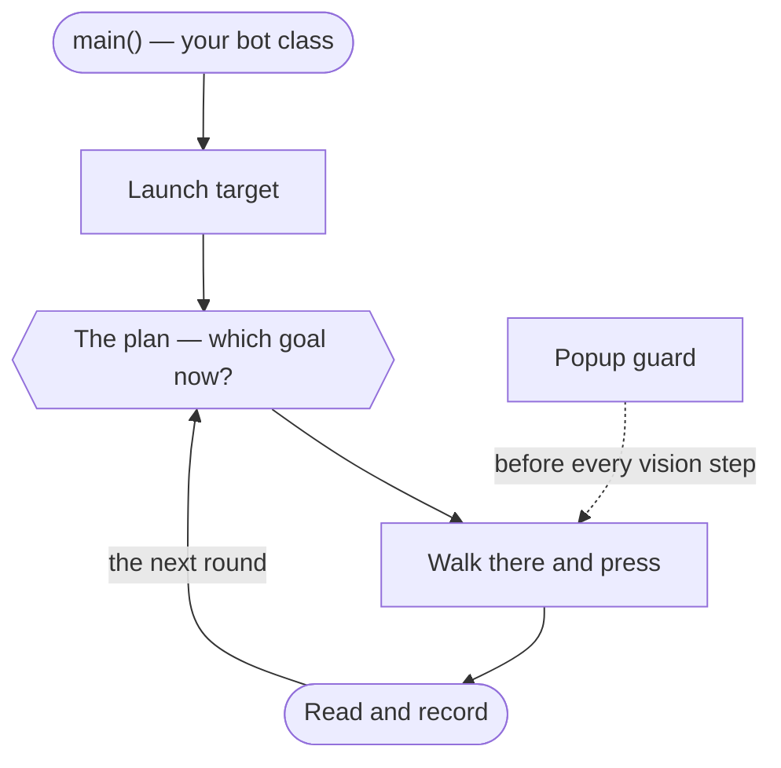

# The BotMaker workflow

<!-- Generated from com.botmaker.studio.docs.Workflow — edit that class, not this file.
     Regenerate: mvn -q exec:java -Dexec.mainClass=com.botmaker.studio.docs.WorkflowMarkdown -->

A BotMaker bot watches a game or app on your screen, decides what it sees, and clicks. You build it out of visual blocks in Studio, and Studio writes the Java for you — a real Maven project you could open in any IDE. The steps below are the order things are normally done in. A plain program needs only the first and the blocks; a game bot needs the BotMaker SDK plugin and the steps between.

## How a bot runs

Your bot is not a script that runs top to bottom. Each round, the plan you picked looks at what the bot knows of the game, takes the goal that matters most and is not met yet, walks the screen map to an action that serves it, and presses it — so the shape of a run is a loop, and it is your plan's tiers that decide what comes next. Goals, plans and screens are ordinary Java under plugins/: nothing is generated, and you can read what the bot will do without opening a window.

- **main() — your bot class** — Calls Bot.run(Sdk.class) — "Run the bot's plan" in the insert menu — which installs the map, the plan and the capture source, then supervises the whole run and gets the game back to a known screen through the bot's home method if it crashes or gets stuck.

- **Launch target** — The game or app you declared is started if it isn't already running. Nothing is captured or clicked until it is up.

- **The plan — which goal now?** — The first tier with a goal that is not met and not only waiting, and in it the goal with an action ready. This is the only place that decides what runs next.

- **Walk there and press** — The run walks the screen map to the screen holding the action that serves that goal, then presses it: a button, or a method of yours run on that screen (a Custom input).

- **Read and record** — The facts the action changes are read again, and when it went through, the run records it — what a daily or a timer looks at next time.

- **Popup guard** (before every vision step) — Before every vision step, whatever is being pressed, the popups of the bot's screen map that show are closed by their way out, so a daily reward covering the button is dismissed in one place instead of by every action that might trip over it. A method of yours can switch it off around a step that works through a popup itself.

Then the plan picks again, from what the bot knows now. When nothing is due it waits for the soonest goal that will be; a run ends when every goal is met for good or nothing can move a tier forward, and says why.

## 1. Create a project

> ＋ New bot on the home screen: start from Blank, or from a bot someone published.

A project is a normal Maven project under ~/BotMakerProjects/. Blank gives you a pom.xml and a main class that prints a greeting, and names no plugin. Starting from a published bot clones it at the release its listing names, and keeps a link to its author, so their later releases reach you as updates.

Every file is yours from the moment it lands, to rename, split up or delete: there is no generated half and nothing is locked.

## 2. Add the plugins it needs

> A plugin brings blocks, value editors and windows; a game bot needs the BotMaker SDK.

Adding a plugin is a dependency in the pom, like any Maven library. The SDK brings the Basics plugin with it, and its own files land under plugins/ in your package, once. The rest of this guide, up to the blocks, is the SDK's.

*In Studio:* Project ▸ Plugins & Libraries…

## 3. Pick the game

> Which game this bot plays on this computer: from Steam, Heroic, Faugus, Lutris, Waydroid or the app menu.

This comes before what the bot reads for a practical reason: you cannot pick the window the bot watches until the game is on screen. The game button starts it without running the bot.

The bot lists the launchers it supports (launchTargets), preferred first, and that list is published with it. Which one a run starts (launchTarget) is a parameter of whoever runs the bot, so it stays on their computer.

*In Studio:* the game button at the start of the toolbar, named after the game (contributed by the BotMaker SDK)

## 4. Point the bot at what it reads

> A window, a monitor, the whole desktop, or an Android emulator.

Everything visual is relative to this one choice. Picture search, reading text, colour checks and every click are measured inside it, so a bot written against a game window keeps working when that window moves or is resized.

It is a parameter (captureSource), so it belongs to the computer that runs the bot and is never published: whoever installs your bot picks their own.

*In Studio:* ⌖ Point bot at… on the toolbar (contributed by the BotMaker SDK)

## 5. Cut pictures

> Little pictures of buttons, icons and text that the bot finds on the screen.

An overlay opens over what the bot reads, so you can draw a rectangle or an ellipse, or cut an object out with a transparent background so the match ignores whatever is behind it. Each picture becomes a constant of your Pictures class (Pictures.COLLECT).

Pictures are filed by tag, not by folder: a picture two screens use carries both tags rather than being copied.

*In Studio:* ✂ Cut picture on the toolbar (contributed by the BotMaker SDK)

## 6. Manage your pictures

> Elements, in the Screens window's rail, is the one list of what the bot finds things by.

Rename, retag, replace, delete, import and export pictures there, and see the tree elements found in a page's or an app's tree.

*In Studio:* 🗺 Screens on the toolbar, then 🧩 Elements in its rail (contributed by the BotMaker SDK)

## 7. Map the game's screens

> Each screen the bot can be on, how it knows it is there, and the buttons that lead on.

A screen is a class of your bot: the pictures that say the game is on it, and its inputs — the buttons that open another screen, and the actions you want the bot to take there (a Do field). The run walks this map to wherever an action is, so no method of yours ever clicks its way from one screen to the next.

Work a press cannot say — a puzzle, a fight — is a Custom input: a plain method of yours, run when the bot is on that screen. 🔭 Explore, in the same rail, runs the bot through the game to find screens you have not mapped yet.

*In Studio:* 🗺 Screens on the toolbar (contributed by the BotMaker SDK)

## 8. Say what the bot wants — facts, goals and plans

> A fact is what the bot knows of the game; a goal is a check on facts; a plan is tiers of goals.

A fact is a method of a @Facts group, and a screen's readout says where on the screen it is read and how long a reading holds. Goals.java holds the checks — gold at least 100, today's reward claimed — and each action says which goal it serves. Plans.java orders them in tiers: the run works the first tier with a goal still unmet, then the next. "How a bot runs" above is what that looks like at run time; read it first, because a bot's actions do not run top to bottom, once each.

Which plan runs is a parameter, so whoever runs the bot can pick another. These are ordinary Java files, readable without opening the window.

*In Studio:* 🗺 Screens on the toolbar, then 🎯 Goals in its rail (contributed by the BotMaker SDK)

## 9. Give the bot its parameters

> The numbers, texts, durations and switches your logic reads — one list for the whole project, in cards by group.

A parameter belongs to the project, not to one method: the delay two methods both wait for is one parameter they both read, rather than a copy each. Its group class says which card it is shown under, and nothing more.

Each one is a method of a @Param group in the package Studio keeps for it (params), its body the value — so your blocks say Mining.maxAttempts(), the compiler checks the type, and deleting a parameter something still reads is a compile error rather than a surprise at run time. The values are yours and private, never committed or published: the committed starting-params/ holds the values whoever runs the bot starts with.

Mark a parameter with @Param.Shown to offer it to whoever runs the bot: those appear in the Runner under their group's heading, and the rest stay yours.

*In Studio:* Project ▸ Parameters… (or 🎚 Parameters on the toolbar)

## 10. Write the logic with blocks

> The centre of the window is your program: loops, conditions, clicks and picture searches as blocks.

Press + between two blocks, or + Add a block, and pick one from the Search blocks… menu, which lists Studio's blocks and those of every plugin the project has. A slot takes a value of its type and refuses one that would not compile.

Blocks are the Java, not a picture of it: every edit rewrites the real source, and an edit made in another editor comes back as blocks. Nothing is trapped in a format only Studio can read.

## 11. Run and debug

> ▶ Run runs the bot; 🐞 Debug runs it and pauses at its breakpoints.

The Run tab shows what the bot printed and its trace, and the status bar's ⚠ problems what did not compile, with the failing block marked on the canvas. A breakpoint is set in a block's gutter; while paused, the Debug tab shows the call stack and the variables.

If a bot needs to run without taking over your screen, it can run on a private display — a nested X server it owns — so you keep using your machine while it works.

## 12. Read the run's report

> Every run keeps a log: what it did, what it read, and why it stopped.

The Reports window lists past runs. A report shows what the run did step by step, charts of the values it read, and the problems it met.

*In Studio:* ▤ Reports on the toolbar

## 13. Watch and drive it from your phone — Remote Pilot

> Streams what the bot sees to a phone or a browser, and lets you start, stop and touch it from anywhere.

Scan the QR code to pair; no VPN and no port forwarding. Turning on Interact makes the stream two-way, so a tap on your phone lands as a click in the game at the right coordinate whatever the stream is scaled to.

*In Studio:* 🎮 Pilot on the toolbar (contributed by the BotMaker SDK)

## 14. Publish and share

> Release the bot from your own GitHub repository, and list it in the catalog.

Publish tags a release, attaches a .bmk — the bot packed to run, with its sources, starting values and the jars it needs — and opens the catalog's pull request. A machine checks the listing and merges it; nobody reviews it by hand.

Your parameters are never in it: a parameter's value, the game you picked and what the bot reads stay on your computer. Project ▸ Export .bmk… makes the same file without publishing.

*In Studio:* Project ▸ Publish to Gallery…

## 15. Get more bots

> Run someone else's bot, or see how one is put together.

A bot you get opens in the Runner — someone else's bot is something you run — with its own parameters to set, and a newer release offered when its author makes one. Its code is shown with every edit refused rather than hidden, so you can read how it works. "Improve this bot" turns it into an ordinary project of yours, for good.

*In Studio:* Project ▸ Get More Bots… (the home's Get more bots)

## Further reading

- [docs/display-pipeline.md](../docs/display-pipeline.md) — capture → encode → transport → render, and the path a touch takes back — for both the pilot's stream and a bot's own read of the same pixels
- [the umbrella CLAUDE.md](../CLAUDE.md) — how the modules fit together, the JitPack coordinate model, and how a release is cut
- [CHANGELOG.md](CHANGELOG.md) — what landed in each release, and what is unreleased
