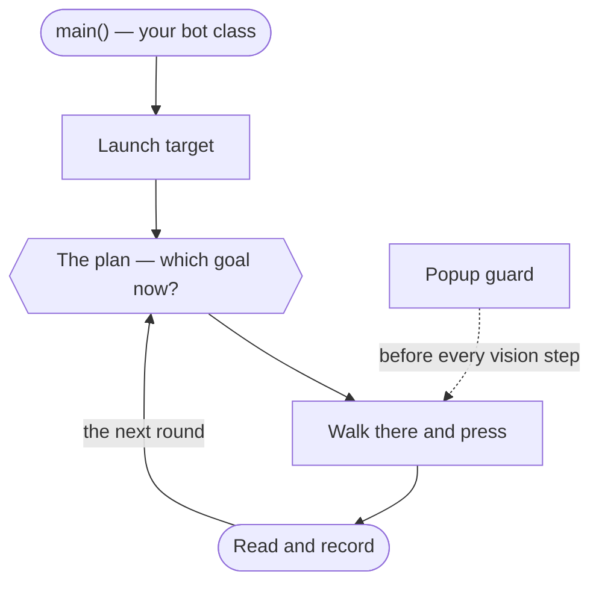

# The BotMaker workflow

<!-- Generated from com.botmaker.studio.docs.Workflow — edit that class, not this file.
     Regenerate: mvn -q exec:java -Dexec.mainClass=com.botmaker.studio.docs.WorkflowMarkdown -->

A BotMaker bot watches a game or app on your screen, decides what it sees, and clicks. You build it out of visual blocks in Studio, and Studio writes the Java for you — a real Maven project you could open in any IDE. The steps below are the order things are normally done in; only the first three are mandatory before a bot can do anything useful.

## How a bot runs

Your bot is not a script that runs top to bottom. Each round, the plan you picked looks at what the bot knows of the game, takes the goal that matters most and is not met yet, walks the screen map to an action that serves it, and presses it — so the shape of a run is a loop, and it is your plan's tiers that decide what comes next. Goals, plans and screens are ordinary Java under plugins/: nothing is generated, and you can read what the bot will do without opening a window.

- **main() — your bot class** — Calls Bot.run(Sdk.class) — "Run the bot's plan" in the insert menu — which installs the map, the plan and the capture source, then supervises the whole run and gets the game back to a known screen through the bot's home method if it crashes or gets stuck.

- **Launch target** — The game or app you declared is started if it isn't already running. Nothing is captured or clicked until it is up.

- **The plan — which goal now?** — The first tier with a goal that is not met and not only waiting, and in it the goal with an action ready. This is the only place that decides what runs next.

- **Walk there and press** — The run walks the screen map to the screen holding the action that serves that goal, then presses it: a button, or a method of yours run on that screen (a Custom input).

- **Read and record** — The facts the action changes are read again, and when it went through, the run records it — what a daily or a timer looks at next time.

- **Popup guard** (before every vision step) — Before every vision step, whatever is being pressed, the popups of the bot's screen map that show are closed by their way out, so a daily reward covering the button is dismissed in one place instead of by every action that might trip over it. A method of yours can switch it off around a step that works through a popup itself.

Then the plan picks again, from what the bot knows now. When nothing is due it waits for the soonest goal that will be; a run ends when every goal is met for good or nothing can move a tier forward, and says why.

## 1. Create a project

> A project is a normal Maven project under ~/BotMakerProjects/.

Studio writes the pom.xml and the project's first sources — an entry point, the screen map, goals and plans, the parameters — and then never writes them again. There is no generated half and nothing is locked: every file is yours from the moment it lands, to rename, split up or delete. A plugin you add later puts its own file under plugins/ the same way, once.

## 2. Tell the bot what to launch — the launch target

> What gets started before the bot runs: a Steam, Epic, Heroic or Faugus game, an executable, a command line, or an app inside an emulator.

This comes before the capture target for a practical reason: you cannot pick the window the bot watches until the game is on screen. Launch it from here first, then choose what to capture.

Studio scans your installed libraries so you pick a game from a list instead of typing an app id. Choosing an emulator app can also point the capture target at that emulator in the same move — a tickbox in the dialog, since it is a convenience and not a rule.

The launch target is yours and is stripped when you publish. What does travel is what you declare in the Publish dialog: the kinds of launch target your bot is known to work with. That is advice for whoever installs it — they still get to try anything on their machine — so declare what you actually tested, not what you hope works.

*In Studio:* 🚀 on the toolbar — it shows the current target

## 3. Tell the bot what to watch — the capture target

> Where the bot looks: a monitor, a window, the whole desktop, or an Android emulator.

Everything visual is relative to this one choice. Image search, OCR, colour sampling and every click coordinate are expressed inside the capture target, so a bot written against a game window keeps working when that window moves.

Like the launch target, this belongs to the machine that runs the bot, not to the bot. It is not published: when you install someone else's bot you pick your own.

*In Studio:* 🎯 Capture Targets on the toolbar (contributed by the BotMaker SDK)

## 4. Capture image templates

> Little pictures of buttons, icons and text that the bot matches against the screen.

An overlay opens over your game so you can draw a rectangle or an ellipse, or cut an object out with a transparent background so the match ignores whatever is behind it. "Capture many" takes a batch in one pass and names them together.

Templates are organised by tag, not by folder — a template used by two screens carries both tags instead of being copied. Tags render as folders in the pickers and in the Resource Manager, where you can also rename, re-tag or delete a template, and export a set as a .bmtemplates file to import into another project.

*In Studio:* ✂ on a screen's panel in 🗺 Screens (contributed by the BotMaker SDK)

## 5. Manage your resources

> The Resource Manager is the one list of every template in the project.

Rename, preview, re-tag, delete, import and export all happen here, and they go through the template library so the tag manifest can never drift from the files on disk.

*In Studio:* 🗺 Screens on the toolbar, then 🖼 Pictures in its rail (contributed by the BotMaker SDK)

## 6. Map the game's screens

> Each screen the bot can be on, how it knows it is there, and the buttons that lead on.

A screen is a constant of your Screens class: the pictures that say the game is on it, and its inputs — the buttons that open another screen, and the actions you want the bot to take there (a Do field). The run walks this map to wherever an action is, so no method of yours ever clicks its way from one screen to the next.

Work a press cannot say — a puzzle, a fight — is a Custom input: a plain method of yours, run when the bot is on that screen. Rename or delete it and the compiler says so, pointing at the screen.

*In Studio:* 🗺 Screens on the toolbar (contributed by the BotMaker SDK)

## 7. Say what the bot wants — goals and plans

> A goal is a check on what the bot knows of the game; a plan is tiers of goals.

Goals.java holds the checks — gold at least 100, today's reward claimed — and each action says which goal it serves. Plans.java orders them in tiers: the run works the first tier with a goal still unmet, then the next. "How a bot runs" above is what that looks like at run time; it is worth reading first, because a bot's actions do not run top to bottom, once each.

Which plan runs is a parameter, so whoever runs the bot can pick another. Both files are ordinary Java under plugins/, readable without opening the window.

*In Studio:* 🗺 Screens on the toolbar, then 🎯 Goals in its rail (contributed by the BotMaker SDK)

## 8. Give the bot its variables

> The numbers, texts, durations and switches your logic reads — one list for the whole project, organised by category.

A variable belongs to the project, not to one method: the delay two methods both wait for is one variable they both read, rather than a copy each. Its group class says where it is filed in the window and nothing more — a variable of the Mining group is still readable from anywhere.

Each one is a method of a @Param group in the package Studio keeps for it (params), its body the value — so your blocks say Mining.maxAttempts(), the compiler checks the type, and deleting a variable something still reads is a compile error rather than a surprise at run time. The values are yours and private: the committed starting-params/ holds the starting values whoever runs the bot begins with.

Mark a variable shown with @Param.Shown to offer it to whoever runs the bot: those appear in the Runner under their group's heading, and the rest stay yours.

*In Studio:* Project ▸ Parameters… (or 🎚 Parameters on the toolbar)

## 9. Author the logic with blocks

> The centre canvas is your program: drag blocks to build loops, conditions, clicks and image searches.

Blocks are the Java, not a picture of it — every edit rewrites the real source through the AST, and every source edit comes back as blocks. Nothing is trapped in a format only Studio can read.

Blocks that call the SDK come from the palette on the left, grouped by facade: vision, interaction, capture, timing. Expression slots accept a drop from the palette or an existing expression, and refuse a drop whose type would not compile.

## 10. Author over the running game — the Overlay Editor

> An always-on-top HUD that mirrors your program as one-line rows over the game itself.

The only way to write or record a bot without leaving the game. Add blocks where the cursor is, or hit Record and let it write the clicks and drags you perform, then insert the batch where a plugin's overlay offers a place for it.

*In Studio:* ⧉ Overlay on the toolbar

## 11. Run and debug

> Run executes the bot; Debug steps through it block by block with breakpoints.

The Terminal tab shows what the bot printed and the Errors tab what did not compile, with the failing block highlighted on the canvas. A breakpoint is set on the block's gutter, and stepping highlights the block currently executing.

If a bot needs to run without taking over your screen, it can run on a private display — a nested X server it owns — so you keep using your machine while it works.

## 12. Watch and drive it from your phone — Remote Pilot

> Streams what the bot sees to a phone or a browser, and lets you start, stop and touch it from anywhere.

Scan the QR code to pair; no VPN and no port forwarding. Turning on Interact makes the stream two-way, so a tap on your phone lands as a click in the game at the right coordinate whatever the stream is scaled to.

*In Studio:* 🎮 Pilot on the toolbar (contributed by the BotMaker SDK)

## 13. Publish and share

> Push the bot to your own GitHub repo, and optionally list it in the gallery.

Publishing declares which launch targets the bot was tested on and strips the parts of the project that describe your machine. Someone installing it picks their own capture and launch targets; your declaration is shown to them as what is known to work, and it recommends rather than restricts — they can still point the bot at a launcher you never tried.

The Gallery browses what everyone else has published; installing from it creates a normal project you can run, read, and — if you choose to — start editing.

*In Studio:* Project ▸ Publish to Gallery…

## 14. Browse the gallery

> Install someone else's bot, or see how one is put together.

An installed bot opens in the Runner — someone else's bot is something you run — and its code is shown full-colour with every edit refused rather than hidden, so you can read how it works. "Improve this bot" turns it into an ordinary project of yours, for good. A bot you published yourself is never treated as somebody else's, on any machine you are signed in on.

*In Studio:* Project ▸ Get More Bots… (the home's Get more bots)

## Further reading

- [docs/display-pipeline.md](../docs/display-pipeline.md) — capture → encode → transport → render, and the path a touch takes back — for both the pilot's stream and a bot's own read of the same pixels
- [the umbrella CLAUDE.md](../CLAUDE.md) — how the four modules fit together, the JitPack coordinate model, and how a release is cut
- [ROADMAP.md](ROADMAP.md) — what landed when, and what is still on the backlog
